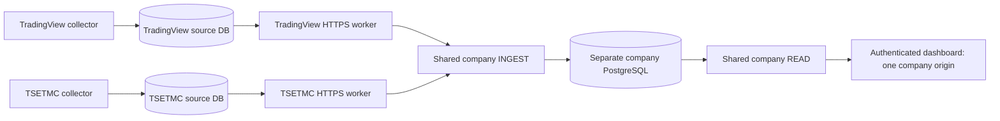

# Shared dashboard integration on audited company storage

Use company `main` containing this integration and TSETMC `main` at af5e180 or
later. The older codex/unified-dashboard-flow company branch contains an incompatible
alternate migration0011: do not deploy or merge that branch. This implementation
preserves the audited migration0011 and its nine tables, numeric measurements,
immutable evidence and journal retention. Existing frozen rc1 archives lack this code.



## Setup

1. Prepare an approved staging company PostgreSQL database; apply this checkout's
   `alembic upgrade 0011`. Apply `scripts/sql/v11_destination_roles.sql`, then
   `scripts/sql/tsetmc_destination_roles.sql` with administrator credentials. Give
   READ and INGEST separate restricted DSNs. Preserve existing producer credentials.
   Never apply company migrations to collector databases.
2. Read the company's `ingest_destination_state.destination_id`. Prepare a private
   JSON file containing the exact `units` object emitted by the approved source
   contract. Keep confidence unverified unless evidence qualifies it. Determine
   the actual source_instrument_id from source metadata; do not invent it. Record
   an approval evidence reference for the intended binding.
3. Generate private matching identities once:

   ```powershell
   uv run python scripts/prepare_tsetmc_connection.py --destination-id ACTUAL-UUID --ins-code ACTUAL-CODE --display-name ACTUAL-NAME --exchange VERIFIED-EXCHANGE --source-instrument-id ACTUAL-SOURCE-ID --units-file C:/private/units.json --approval-evidence YOUR-REFERENCE --endpoint https://YOUR-COMPANY-ORIGIN --output C:/private/tsetmc-connection
   uv run python -m marketdata.tsetmc.admin --dsn-file C:/private/company-admin-dsn --plan C:/private/tsetmc-connection/company-plan.json
   ```

   Setup activates the explicitly approved binding and creates its producer atomically.
   It refuses existing bindings; retry by inspecting state rather than regenerating
   identities. Merge the generated credential object into INGEST's credential array.
   Keep plaintext producer.token only on the source host. Never put it in browser code.
4. On an approved TSETMC staging database, back up and restore-check, stop writers,
   then use the source checkout's `alembic upgrade head` with private
   TSETMC_MIGRATION_URL. Apply its `scripts/delivery_grants.sql`. The protected original
   pilot was not migrated by this work. Set the worker's local TSETMC_DATABASE_URL.
5. Copy source-binding.json, worker.json and producer.token to the source host.
   Update absolute token and external continuity-anchor paths for that host. Preserve
   this anchor outside database backups. Enroll the stored archive and deliver:

   ```powershell
   uv run python -m tsetmc_marketdata.enrollment --binding C:/private/tsetmc-connection/source-binding.json --activate
   uv run python -m tsetmc_marketdata.delivery --config C:/private/tsetmc-connection/worker.json --seconds 3600 --activate
   ```

6. Enable COMPANY_TSETMC_ENABLED=true on company READ/INGEST and
   TSETMC_INGEST_ENABLED=true on INGEST. The opt-in compose.company-unified.yaml
   builds the current checkout against an existing network/database. Route
   /api/ingest/v1/* to INGEST and /api/v1/* with WebSocket upgrades to READ at one
   verified HTTPS origin. Configure the company's actual login/BFF and trusted
   gateway addresses. No deployment or service activation is performed by setup.

## Frontend

examples/unified-dashboard.mjs uses one origin with explicit market semantics.
International discovery remains /api/v1/instruments; Iranian discovery is
/api/v1/tsetmc/instruments. Both paginate with next_after. Existing international
DTOs remain unchanged; the client provides iranianSources() for Iranian discovery.

Iranian routes: /api/v1/tsetmc/latest, /daily, /coverage, /changes and
/api/v1/ws/tsetmc, scoped by ins_code. History requires Gregorian start/end date
labels, uses inclusive start/exclusive end, and defaults to finalized. Explicit
accepted-unverified selection exposes accepted history without claiming finality.
There is no native Iranian minute history. Values remain decimal strings; last
trade, official close, traded volume and traded value remain distinct.

Latest reports original source age and receive age independently. A recent receipt
does not make an old source price fresh. Delivery remains unknown and real-time
availability is false. Stored data remains readable while collectors are offline.
WebSockets send a snapshot then journal changes. Keep the last processed cursor;
an invalid epoch or cursor below the retained floor requires a fresh snapshot.
For daily pagination retain the first snapshot_cursor and replay subsequent changes.

## Qualification limits

The earlier branch's 663 company/365 source tests describe that earlier implementation,
not this reconciled code. Current validation is recorded in HANDOFF.md and GitHub CI.
The audited storage already supports bounded journal pruning; configure retention
for the dashboard reconnect window. Source delivery still has a 10,000 retained-batch
startup audit ceiling and uses the trusted local collector database principal.
Dedicated worker SQL permissions and long-running archival need qualification.
Real 99-feed selection/coverage, company TLS/login, source rights and restore rehearsal
remain deployment acceptance work. No production is currently active.
