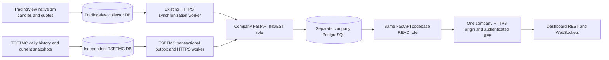

# One company interface for international and Iranian market data

This is the **source-checkout integration**, built on the existing independent
TradingView collector and company API, plus the TSETMC collector. The delivered
v1.0 and v1.1.0rc1 archives are unchanged and do not contain this integration.
Use the matching integration commits in both repositories. Do not mix the new
source binary with the protected original TSETMC pilot's old schema.



READ and INGEST use separate database privileges and processes from one company
application image. Both sit behind one gateway. Neither starts a collector.
Collectors hold only their local database credentials and their own HTTPS producer
token. The dashboard never connects to collector databases. Stored history and
latest observations remain readable during collector/worker outages; source ages
continue increasing and expired status is explicit.

## What the inspection established

| Requirement | Finding |
|---|---|
| TradingView native historical 1m data, latest quotes, corrections | Existing dual collector, PostgreSQL persistence, recovery and sync worker implement this. Earlier artifacts document a brief genuine BTC qualification and synthetic 99-feed pipeline qualification. This session did not establish sustained genuine coverage of all feeds. |
| Approximately 99 international feeds | Existing documents distinguish the 100-source accuracy registry from a 99-feed proposal (57 common, 43 accuracy-only, 42 proposal-only). Do not silently select a different universe. Approve and qualify the intended registry before production. |
| TSETMC history/current | Existing collector and prior reports cover Foolad. Native daily history is not minute history. The collector preserves last trade separately from official close and volume separately from value. |
| TSETMC delivery to company | Previously missing. This change adds genuine HTTPS delivery primitives and company routes; tests use invented data only. |
| One independently deployed company backend | Existing READ/INGEST separation is reused; the new provider namespace is in the same API application and database. |
| Frontend integration | `examples/unified-dashboard.mjs` gives one client/origin for source discovery, latest, history and stream URLs. Response semantics remain explicit for each market. |
| Production readiness | Not established by local tests. Actual source rights/access, company deployment/TLS/auth, sustained feed coverage, operations and restore rehearsal remain site work. |

## First-install / reviewed upgrade sequence

1. Back up and restore-check the intended **company** database. Install this checkout
   with `uv sync --locked`. Set its administrative `DATABASE_URL` privately and run
   `uv run alembic upgrade 0011`. This is the company lineage only. Never run it on
   either collector DB. Existing 0001–0010 migrations were not modified.
2. For a new company installation, apply `scripts/sql/v11_destination_roles.sql` as
   administrator, then `scripts/sql/tsetmc_destination_roles.sql`. On an existing
   installation with those roles, apply only the latter reviewed grants. Give READ
   and INGEST separate secret DSNs. Neither runtime gets the administrator DSN.
3. Read `SELECT destination_id FROM ingest_destination_state` on that company DB.
   Create one matching private handoff with the command below. Supply the actual
   company HTTPS origin and verified exchange label. This generates new UUIDs and
   a strong producer token once, and refuses an existing output directory:

   ```powershell
   uv run python scripts/prepare_tsetmc_connection.py --destination-id ACTUAL-UUID --ins-code 46348559193224090 --display-name "فولاد" --exchange VERIFIED-EXCHANGE --endpoint https://YOUR-COMPANY-ORIGIN --output C:/private/tsetmc-connection
   ```

4. On the company host, provision the plan using an administrator DSN file:

   ```powershell
   uv run python -m marketdata.tsetmc.admin --dsn-file C:/private/company-admin-dsn --plan C:/private/tsetmc-connection/company-plan.json
   ```

   Merge the **single credential object** in `producer-credential.json` into the
   existing company `ingest_credentials.json` array. Keep existing TradingView
   entries. The file contains token hashes, not plaintext tokens. Restart INGEST
   after loading the merged file. The plaintext `producer.token` stays only on
   the TSETMC host. Do not paste secrets into Git, browser code, or logs.
5. Upgrade a separately approved TSETMC database to `0005_delivery`, after stopping
   its writers and verifying a backup. Its migration command is the TSETMC
   checkout's `uv run alembic upgrade head` with private `TSETMC_MIGRATION_URL`.
   Apply `scripts/delivery_grants.sql` from that checkout as its database owner;
   it grants the collector principal access to the new coordinator table.
   **This session did not upgrade or enroll the protected original pilot.**
6. Set `TSETMC_DATABASE_URL` to that local TSETMC database. With its collector
   paused briefly, enroll the already stored archive (no provider fetch):

   ```powershell
   uv run python -m tsetmc_marketdata.enrollment --binding C:/private/tsetmc-connection/source-binding.json --activate
   uv run python -m tsetmc_marketdata.delivery --config C:/private/tsetmc-connection/worker.json --seconds 3600 --activate
   ```

   Enrollment is capped at 10,000 daily records / 32 MiB. It preserves accepted
   measurements, revisions, reviews and uncertainty. Reuse the seed identity on
   retry; never regenerate UUIDs to get past a mismatch. `--drain` exits after the
   current backlog is delivered. Without it, the foreground worker polls for new
   committed outbox entries within the chosen window. It does not fetch TSETMC.
   Continue using the collector's documented bounded scheduler for acquisition.
7. Set `COMPANY_TSETMC_ENABLED=true` for both company roles. Route `/api/ingest/v1/*`
   to INGEST and `/api/v1/*` (including WebSocket upgrades) to READ at the same
   company origin. Configure verified TLS and an explicit trusted gateway IP.
   `compose.company-unified.yaml` is an opt-in source-build runtime template using
   an existing company DB/network; it does not create, migrate or delete databases.
   For native processes use `marketdata.production api` / `marketdata.production ingest`
   with mounted/private DSN and token files as documented in the existing deployment guide.

On Linux change the worker's absolute token/anchor paths after copying the private
handoff. `ca_file` may specify a private CA; omitting it uses the system CA store.
Never disable certificate verification. Keep the continuity anchor outside database
backups and preserve it across worker restarts. No installed service or deployment
was activated by this change.

## Dashboard contract

All routes below belong to the **same company API** and use its existing bearer
authentication. A company BFF must validate its real user session before forwarding
service authorization and the allowed browser Origin. The example BFF remains
provisional; this repository does not supply the company's login system.

| Purpose | International | Iranian |
|---|---|---|
| Discover mappings | `/api/v1/instruments` (both markets; canonical identity includes provider) | Same endpoint; `asset_class=equity`, `instrument_type=common_stock` |
| Latest | `/api/v1/prices/latest` | `/api/v1/tsetmc/latest?ins_code=...` |
| History | `/api/v1/candles?symbol=...&provider=...&interval=1m&start=...&end=...` | `/api/v1/tsetmc/daily?ins_code=...&start=2007-01-01&end=2027-01-01&selection=accepted-unverified` |
| Coverage | `/api/v1/coverage` | `/api/v1/tsetmc/coverage?ins_code=...` |
| Streaming | `/api/v1/ws/marketdata`, existing subscribe protocol | `/api/v1/ws/tsetmc?ins_code=...`, initial snapshot then committed changes/heartbeats |
| Replay | Existing `/api/v1/changes` | `/api/v1/tsetmc/changes?ins_code=...&after=CURSOR` |

TSETMC history defaults to **finalized**, which can legitimately be empty. Choosing
`accepted-unverified` exposes accepted source history without claiming upstream
finality. Dates are Gregorian labels, not midnight trades. Financial values are
decimal strings; `official_close` can be outside the executed low/high range.
`last_traded_price`, `traded_volume`, `traded_value`, and `trade_count` are distinct.
No Toman conversion, corporate-action adjustment, zero filling or price substitution
is performed. Units retain the source's unverified confidence.

`latest.current` is a polled snapshot, not a tick stream. Source and receipt ages
are separate. `fresh` means source time is within 120 seconds; it never implies
verified real-time delivery (`realtime_quote_available` stays false). `status_expired`
uses the source's original expiry, not upload time. Discovery's legacy native-candle
availability fields describe the international storage; use the TSETMC routes for
Iranian availability and history. The client adapter handles this routing.

Paginate daily history with `next_after` and keep the same date bounds/selection.
Keep the **first** page's `snapshot_cursor`, load all pages, then replay changes
after that cursor to apply corrections made during pagination. On reconnect retain
the last processed cursor and deduplicate `event_id`; delivery may repeat events.
An invalid/wrong-epoch cursor requires a fresh REST snapshot. WebSocket clients
have a per-worker limit and send deadline; a slow/disconnected client resumes with
its cursor. A periodic heartbeat is not a new market observation.

## Safety, recovery and current limits

Source staging preserves exact bytes before HTTPS. A validated company receipt
commits locally before source ACK. Daily/coverage lanes are lossless prefixes;
current/status heads coalesce. Company data, immutable observation ledger, event
journal and receipt commit together. TSETMC official prices never enter TradingView
minute candles. JSONB projections retain canonical decimal strings exactly; typed
source PostgreSQL NUMERIC values and wire hashes are preserved without float conversion.

One coordinator owns one TSETMC producer/instrument. It shares the existing short
instrument transaction fence with collection and never holds it during HTTPS.
Separate producers are required for separately operated instruments. Authentication,
manifest/epoch/generation mismatch, restored-source regression, missing committed
company receipts and changed identities stop delivery for administrator review.
Do not fix these by resetting cursors or replacing epochs. Company reads continue.

The worker retains batches and audits receipts at startup, with a 10,000-batch audit
ceiling. Source outbox budgets also fail closed. No automatic evidence pruning or
company journal retention is implemented for this extension yet. Monitor storage;
qualify archival/retention and longer-running restart/restore behavior before an
unattended production rollout. The worker uses a local trusted collector database
principal for short fenced transactions; a dedicated SQL-function-only worker role
is a remaining hardening task. Real source finality, all-market session calendars,
broader Iranian instrument qualification and sustained genuine 99-feed acquisition
are not established by this implementation.

See `unified-dashboard-verification.md` for the exact tests and remaining limits.
